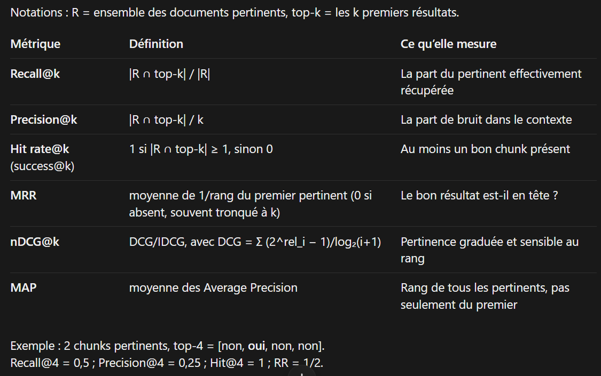

Lil Weng Agents :
- Chain of Thought (CoT) -> think step by step, now included in harnesses (before, prompting technique)
- Tree of Thoughts -> BFS or DFS extension of CoT 
- LLM+P -> Planning
- ReAct -> Reasoning + Action, very popular, better performance than reasoning alone or action alone
MEMORY
- Short Term (context), long-term memory (vector store, rag)
MIPS (Maximum Inner Product Search) -> done in vector database to find related info (load memory)
Common choice is ANN (Approximate Nearest Neighbors) algo, returns top k nearest (not 100% accurate, but huge speedup)
ANN Algo examples : LSH, ANNOY, FAISS (Facebook AI Similarity Search)
TOOL USE
Metrics de RAG :

